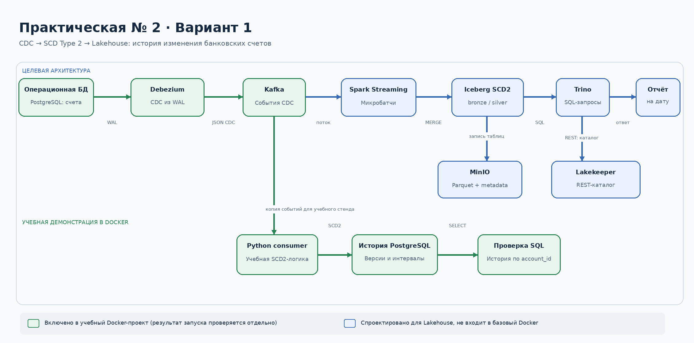
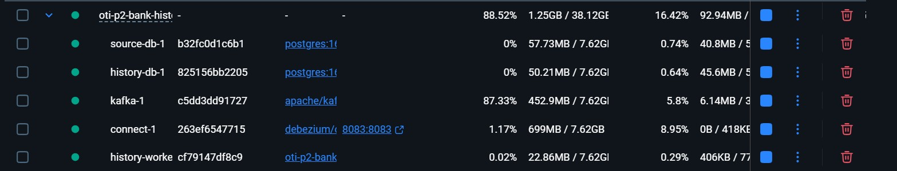
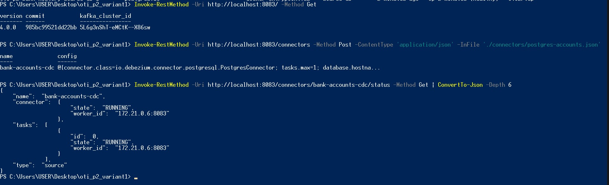
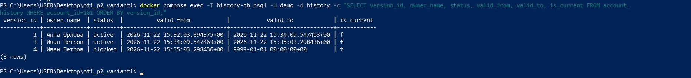
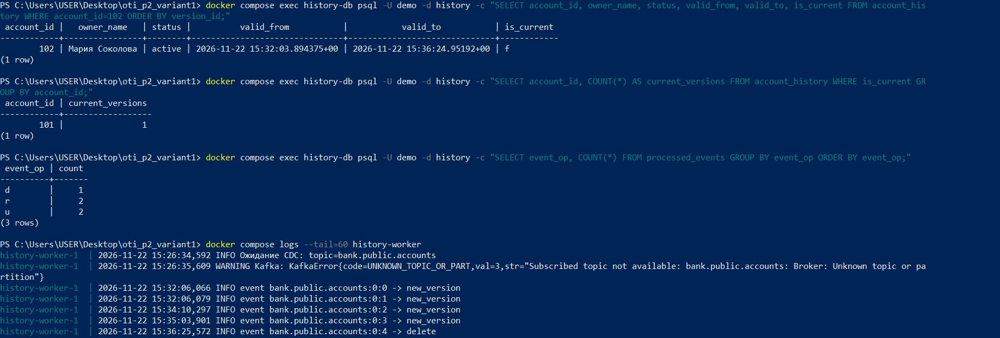

# Отчёт по практической № 2

> Данные о запуске Docker и результаты SQL-запросов получены при проверке проекта 22.11.2026. Целевая архитектура Lakehouse разработана на уровне схемы; её компоненты не запускались.

## 1. Вариант и задача

| **Поле** | **Значение** |
| --- | --- |
| ФИО (как в VK Education) | Барателия Аида Дмитриевна |
| Тема | Вариант 1 – CDC → SCD → Lakehouse |
| Состав решения | PostgreSQL (операционная база) → Debezium (чтение WAL) → Kafka (журнал изменений) → Spark Structured Streaming (микробатчи и обработка CDC) → таблицы Iceberg в MinIO, каталог Lakekeeper → запросы через Trino. Отдельно в Docker-проекте есть небольшой Python-потребитель, который на практике показывает SCD Type 2 в PostgreSQL. |
| Данные, объём | Для примера взят справочник банковских счетов: `account_id`, владелец, статус, время изменения. В учебной базе сначала 2 счёта; затем вручную создаются обновления и удаление. Для проектируемой системы предполагаются десятки или сотни тысяч счетов и постоянно поступающие изменения. Это проектная оценка нагрузки, а не измеренный объём. |

Я выбрала пример с банковскими счетами, потому что здесь действительно важно знать не только текущее состояние записи, но и то, каким оно было раньше. Например, у счёта мог смениться владелец, или он сначала был активным, потом заблокированным, а затем закрытым. Если просто обновлять одну строку, прежние значения потеряются. Поэтому я хочу сохранять версии записи и иметь возможность восстановить состояние на конкретный момент.

## 2. Источники и способы сбора

| **Источник** | **Тип (поток / batch / CDC / документы в md pdf или другой/ API)** | **Способ сбора** |
| --- | --- | --- |
| `public.accounts` в PostgreSQL | Операционная таблица; источник CDC | Debezium читает журнал WAL через логическую репликацию PostgreSQL. Это удобнее, чем постоянно опрашивать таблицу `SELECT`-ами: источник получает меньше лишней нагрузки, а мы видим вставки, обновления и удаления. |
| Начальное содержимое таблицы `accounts` | Начальный снимок (`snapshot`) | При первом подключении Debezium отправляет существующие строки как события с операцией `r`. После снимка продолжает читать изменения из WAL. |
| Топик Kafka `bank.public.accounts` | Поток событий CDC | Debezium публикует JSON-сообщения с типом операции `c/u/d/r`, полями `before` и `after`, временем источника и служебными данными. Kafka отделяет операционную базу от обработчика истории. |
| События из Kafka для слоя Lakehouse | Streaming / микробатчи | В проектируемом решении Spark Structured Streaming читает события, сохраняет исходные данные в bronze и обновляет SCD Type 2 в silver. Это позволяет не делать тяжёлую аналитику прямо в операционной БД. |

**Почему именно log-based CDC.** Если регулярно делать полный `SELECT` по таблице, придётся каждый раз перечитывать записи, большая часть которых не менялась. Ещё такой подход плохо отслеживает удаления. Чтение WAL позволяет получать изменения, которые PostgreSQL уже зафиксировал в журнале транзакций. Полная выгрузка нужна только для первоначального состояния.

## 3. Архитектура (draw.io безальтернативно)



Исходник схемы: [`architecture.drawio`](architecture.drawio). Схема сделана в редактируемом формате draw.io. Подписи на стрелках показывают, что передаётся между компонентами. Цвета в легенде разделяют две части: зелёным выделен подготовленный учебный Docker-контур, синим – целевая часть Lakehouse, которая пока не развёрнута.

**Как работает основная схема.** Пользователь или банковская система меняет запись в PostgreSQL. Изменение попадает в WAL. Debezium через логическую репликацию получает событие и отправляет его в Kafka, где сообщение может прочитать обработчик. Для Lakehouse я выбрала Spark Structured Streaming с микробатчами: в одном процессе можно сохранять исходные события и применять преобразование в исторические версии. Таблицы Iceberg находятся в объектном хранилище MinIO; Lakekeeper ведёт каталог, а Trino даёт аналитикам SQL-доступ.

**Почему SCD Type 2.** Этот тип создаёт новую строку, когда изменяется важный атрибут. У каждой версии есть собственный `version_id`, бизнес-ключ `account_id`, поля `valid_from`, `valid_to` и `is_current`. Я использую полуоткрытый интервал `[valid_from, valid_to)`: дата начала входит в версию, а дата окончания уже относится к следующей. Так проще избежать ситуации, когда в один момент времени подходят сразу две версии. Для актуальной версии ставится `valid_to = 9999-01-01` и `is_current = true`, как на лекции.

При `INSERT` (`c`) открывается первая версия. При `UPDATE` (`u`), если изменились владелец или статус, старая версия закрывается и появляется новая. При `DELETE` (`d`) текущая версия закрывается, а новой активной версии уже нет. Событие `r` во время первоначального снимка открывает версию состояния на момент снимка. Важно: такой снимок **не восстанавливает** изменения, случившиеся до подключения CDC.

| Событие (пример) | Что происходит с историей |
| --- | --- |
| Счёт 101 создан: Анна, `active` | Появляется первая текущая версия. |
| Владелец поменялся на Ивана | Версия Анны закрывается, начинается версия Ивана. |
| Статус изменился на `blocked` | Версия Ивана со статусом `active` закрывается, появляется новая версия со статусом `blocked`. |
| Счёт удалён из источника | Последняя версия закрывается; история остаётся. |

**Почему не Type 1 или Type 6.** Type 1 перезаписал бы прежнего владельца, поэтому бухгалтерия уже не смогла бы ответить на вопрос о прошлом. Type 6 мог бы хранить и исторические, и дополнительные текущие/предыдущие значения, но для этой задачи это лишняя сложность: достаточно Type 2.

**Почему микробатчи вместо непрерывного streaming.** Смена владельца или статуса счёта не требует отклика за миллисекунды. Мне важнее предсказуемая обработка, восстановление после сбоев и возможность аккуратно закрывать и создавать версии. При больших объёмах Spark может обрабатывать группы изменений, а не записывать каждую версию отдельной операцией.

**Повторы и порядок событий.** Kafka может доставить событие повторно, например после перезапуска обработчика. Поэтому одного обещания «exactly once» недостаточно: при записи в итоговую таблицу нужно проверять уникальный идентификатор события (например, топик + партиция + offset), сохранять checkpoint и делать повторную обработку идемпотентной. Изменения одного `account_id` должны обрабатываться в правильном порядке. В демонстрации журнал обработанных Kafka-offset хранится в той же транзакции PostgreSQL, что и SCD-версии. Для полноценного Iceberg-контура потребуется аналогичная дедупликация/контроль уже применённых событий при `MERGE INTO`.

**Что хранится в Lakehouse.** В `bronze` предполагается сохранять исходные CDC-события – чтобы при ошибке преобразования можно было пересчитать историю. В `silver` находится SCD Type 2: чистая таблица версий банковских счетов. Через Trino можно делать запрос по `account_id` и интересующей дате. Снимки Iceberg полезны для версионирования самого набора файлов и отката, но они не заменяют логическую историю атрибутов в SCD.

## 4. Docker – что поднялось (честно)

**Результат проверки 22.11.2026.** Я запустила учебный стенд на Windows через Docker Desktop. Команда `docker compose config` прошла без ошибок, после `docker compose up -d --build` были запущены все пять контейнеров. Две базы PostgreSQL и Kafka показали статус `healthy`, а Kafka Connect и Python-обработчик – `Up`. Затем я зарегистрировала коннектор Debezium, проверила обработку обновлений и удаления и выполнила запрос к истории на определённый момент времени.

| **Блок** | **Статус (реализовано / нет)** |
| --- | --- |
| PostgreSQL с `public.accounts` | **Реализовано и запущено.** Две начальные записи; изменения `UPDATE` и `DELETE` выполнены успешно. |
| Kafka | **Реализовано и запущено.** Контейнер `healthy`; события поступали в топик `bank.public.accounts`. |
| Debezium Kafka Connect | **Реализовано и запущено.** Коннектор `bank-accounts-cdc` и его задача `0` имеют статус `RUNNING`. |
| Python `history-worker` | **Реализовано и запущено.** В логах видны обработанные события начального снимка, обновления и удаления. |
| PostgreSQL с `account_history` и `processed_events` | **Реализовано и запущено.** Проверены исторические версии, закрытие записи при удалении и журнал пяти событий. |
| Spark Structured Streaming | **Не развёрнут.** Это обработчик для целевой Lakehouse-архитектуры; в учебном стенде его функции историзации показывает Python. |
| MinIO / Lakekeeper / Iceberg / Trino | **Не развёрнуты.** Предусмотрены в проектируемой целевой архитектуре. В работающей демонстрации история хранится в отдельном PostgreSQL. |

**Команды, которые я выполнила:**

```powershell
docker --version
docker compose version
docker compose config
docker compose up -d --build
docker compose ps
Invoke-RestMethod -Uri http://localhost:8083/ -Method Get
Invoke-RestMethod -Uri http://localhost:8083/connectors -Method Post -ContentType 'application/json' -InFile './connectors/postgres-accounts.json'
Invoke-RestMethod -Uri http://localhost:8083/connectors/bank-accounts-cdc/status -Method Get | ConvertTo-Json -Depth 6
```

**Результат `docker compose ps` из PowerShell:**

```text
NAME                                   SERVICE          STATUS
oti-p2-bank-history-connect-1          connect          Up 2 minutes
oti-p2-bank-history-history-db-1       history-db       Up 2 minutes (healthy)
oti-p2-bank-history-history-worker-1   history-worker   Up 2 minutes
oti-p2-bank-history-kafka-1            kafka            Up 2 minutes (healthy)
oti-p2-bank-history-source-db-1        source-db        Up 2 minutes (healthy)
```

Здесь приведены названия, сервисы и статусы из фактического вывода команды (столбцы `IMAGE`, `COMMAND`, `CREATED` и `PORTS` опущены для компактности).

**Проверка коннектора:** в ответе API у `bank-accounts-cdc` состояние `connector.state = RUNNING`, а у `tasks[0]` – `state = RUNNING`.

**Проверка SCD Type 2.** Сначала в источнике находились два счёта: 101 (Анна Орлова, `active`) и 102 (Мария Соколова, `active`). Я заменила владельца счёта 101 на Ивана Петрова, затем установила статус `blocked`. В итоговой таблице для счёта 101 сохранились три версии:

| `version_id` | `account_id` | `owner_name` | `status` | `valid_from` (UTC) | `valid_to` (UTC) | `is_current` |
| --- | --- | --- | --- | --- | --- | --- |
| 1 | 101 | Анна Орлова | active | 2026-11-22 15:32:03.894375 | 2026-11-22 15:34:09.547463 | false |
| 3 | 101 | Иван Петров | active | 2026-11-22 15:34:09.547463 | 2026-11-22 15:35:03.298436 | false |
| 4 | 101 | Иван Петров | blocked | 2026-11-22 15:35:03.298436 | 9999-01-01 00:00:00 | true |

Номера версий `1`, `3`, `4` не являются ошибкой: `version_id = 2` относится к другому счёту, поскольку ключ версии сквозной для всей таблицы истории.

После удаления счёта 102 в исходной базе его запись в истории не исчезла: интервал действия закончился `2026-11-22 15:36:24.951920+00`, `is_current = false`. Запрос на число текущих версий показал одну текущую запись у счёта 101 и ни одной у удалённого счёта 102.

В таблице `processed_events` сохранилось **5** событий: `r` – 2 (начальный снимок), `u` – 2 (обновления), `d` – 1 (удаление). Логи `history-worker` показали последовательную обработку сообщений топика `bank.public.accounts` с offset от 0 до 4. Предупреждение об отсутствии топика появилось до регистрации коннектора; после создания топика сообщения успешно обрабатывались.

**Запрос на исторический момент** вернул `Иван Петров` и `active` для начала второй версии счёта 101 – именно это состояние действительно действовало до блокировки. Так я проверила, что таблица позволяет получить не только текущее состояние, но и предыдущее.

**Ограничения и то, что пока не проверялось.** Показана работа одного учебного запуска, но нагрузочное тестирование, принудительный сбой с повторной доставкой, восстановление из checkpoint и запись SCD в Iceberg не проводились. Журнал `processed_events` предусмотрен для защиты от повторной обработки сообщений, однако отсутствие дубликатов при специально смоделированном сбое здесь не проверялось. Полный Lakehouse-контур изображён как архитектура, а не как запущенные контейнеры.

**Скриншоты проверки.** Ниже приложены снимки из моего запуска 22.11.2026. На третьем снимке показаны три сохранённые версии счёта 101: имена владельцев, статусы, границы действия записей и признак текущей версии. Настройка кодировки терминала позволила получить читаемый вывод.

**1. Контейнеры в Docker Desktop**



**2. Статус Debezium**



**3. Таблица истории SCD Type 2**



**4. Удаление, контроль текущих версий и логи обработчика**



## 5. Описание

| **Шаг** | **Для чего** | **Результат** |
| --- | --- | --- |
| 1. Создаём таблицу `accounts` в PostgreSQL | Имитируем операционную систему с текущими данными. | Есть исходные счета с владельцами и статусами. |
| 2. Включаем логическую репликацию WAL | Даём Debezium возможность читать журнал изменений вместо регулярных тяжёлых запросов. | Изменения доступны для CDC. |
| 3. Debezium делает начальный снимок и читает новые операции | Получаем и начальные данные, и последующие изменения. | События `r`, `c`, `u`, `d` публикуются в Kafka. |
| 4. Kafka хранит и доставляет события | Разделяем исходную БД и обработчик, можем повторно прочитать сообщения. | Обработчик получает поток, не запрашивая таблицу источника. |
| 5. Обрабатываем CDC-сообщения | Понимаем, что произошло: создание, изменение или удаление. | Определяем, какую версию закрыть и какую открыть. |
| 6. Применяем SCD Type 2 | Сохраняем старые значения, не перезаписывая их. | Исторические строки с интервалами действия; в демонстрации – в PostgreSQL, в целевой схеме – в Iceberg `silver`. |
| 7. Сохраняем сведения об обработанных событиях | Избегаем дублирования версий при повторной доставке Kafka-сообщений. | Повтор того же сообщения не создаёт ещё одну строку SCD. |
| 8. Делаем запрос по дате | Проверяем, что цель задания достигнута. | Можно узнать владельца и статус счёта на указанный момент. |

Пример запроса к учебной таблице истории:

```sql
SELECT account_id, owner_name, status, valid_from, valid_to
FROM account_history
WHERE account_id = 101
ORDER BY valid_from;
```

Для ответа именно **на дату** используется условие `valid_from <= момент` и `момент < valid_to`. Даты в таблице должны быть получены из реального прогона, а не подставлены задним числом. Полезно также проверить, что у одного счёта не бывает двух текущих версий одновременно.

## 6. Выводы

Во время проектирования мне стало понятнее, что CDC и SCD решают разные задачи. CDC нужен, чтобы заметить изменение в исходной базе и передать его дальше, а SCD – чтобы правильно сохранить это изменение в истории. Если убрать CDC, придётся постоянно сравнивать полные копии таблицы. Если убрать SCD Type 2, у нас останутся события, но не будет удобной таблицы для ответа на вопрос «какое значение было на дату».

Для выбранного примера больше всего подходит Type 2: он сохраняет предыдущих владельцев и статусы без перезаписи. На схеме я разделила получение изменений, их обработку и хранение истории. Отдельно предусмотрела повторную доставку событий и удаление записи, потому что без этого история легко станет неправильной. Наиболее сложная часть такого решения – не сама запись новой строки, а сохранение правильного порядка событий и отсутствие задвоений при сбоях.

На практике у меня получилось запустить все пять контейнеров учебного стенда и увидеть, как изменение в одной базе превращается в новую версию записи в другой. Я отдельно проверила смену владельца, блокировку и удаление: старые версии сохранились, а запрос на прошлый момент вернул ожидаемый результат. В начале обработчик предупредил, что топика ещё нет, но после регистрации Debezium данные начали поступать. Это помогло мне понять, что при запуске такого конвейера важен не только код, но и правильный порядок подключения компонентов.

## 7. Мой любимый десерт

Мой самый любимый десерт - это шоколадный фондан, потому что мне нравится сочетание холодного ванильного шарика мороженого с тёплой шоколадной булочкой